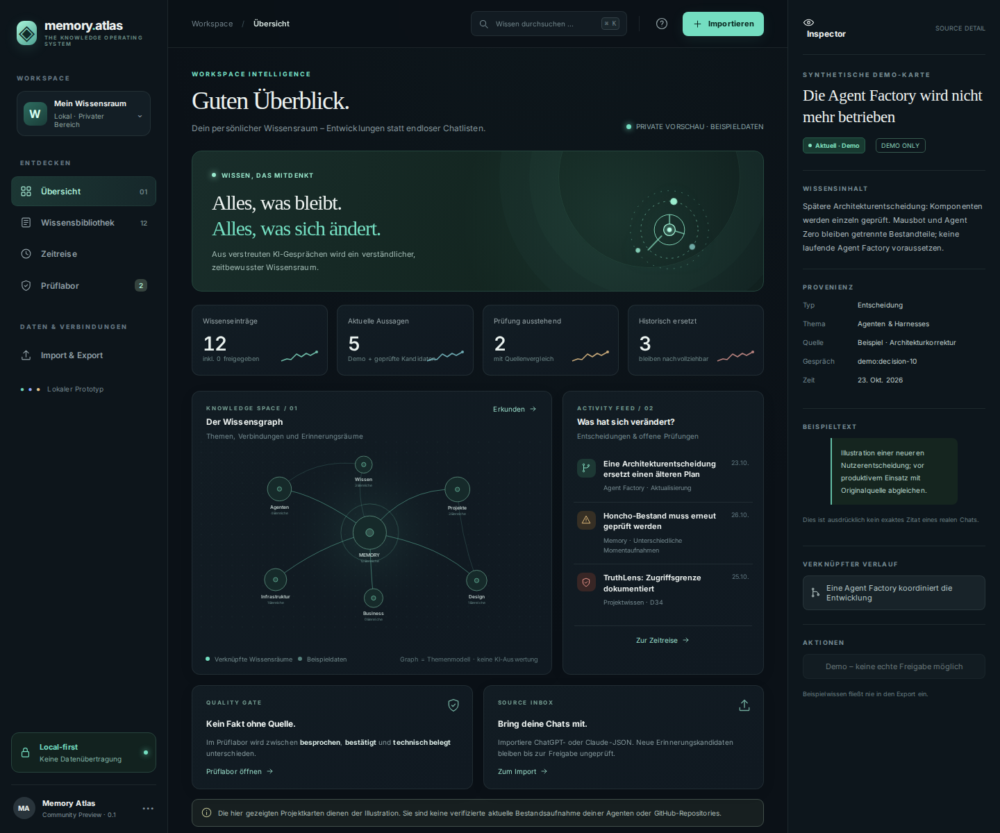
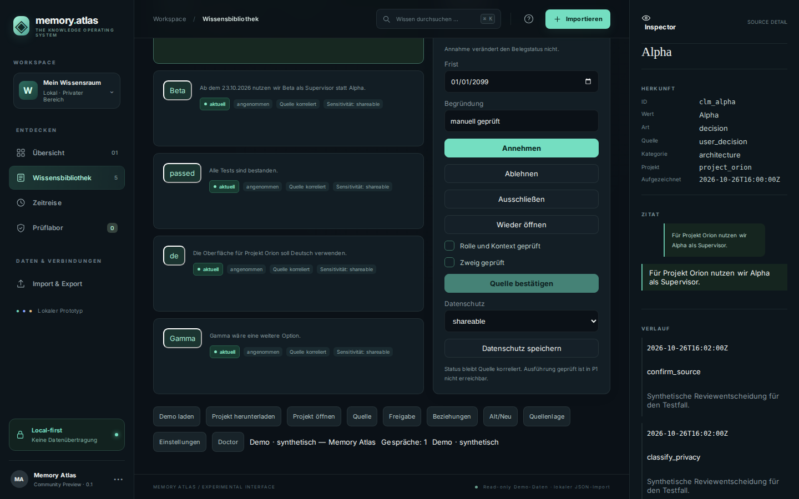
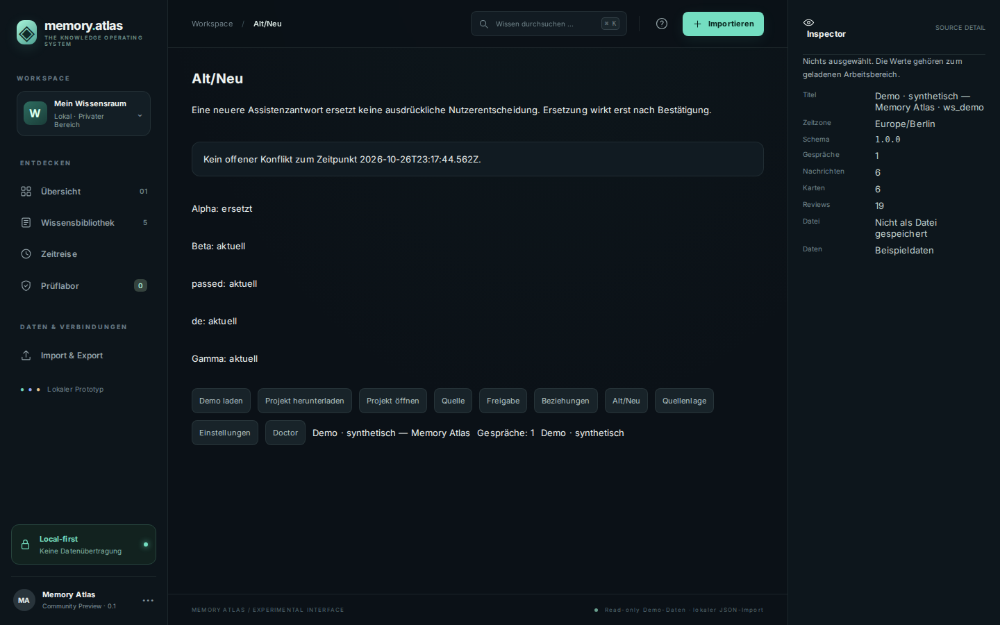
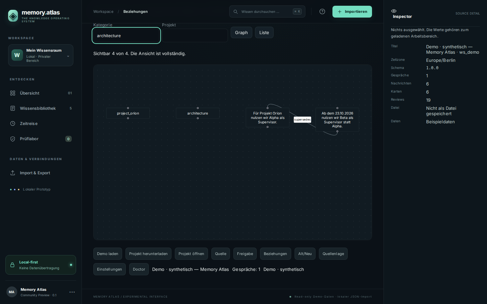
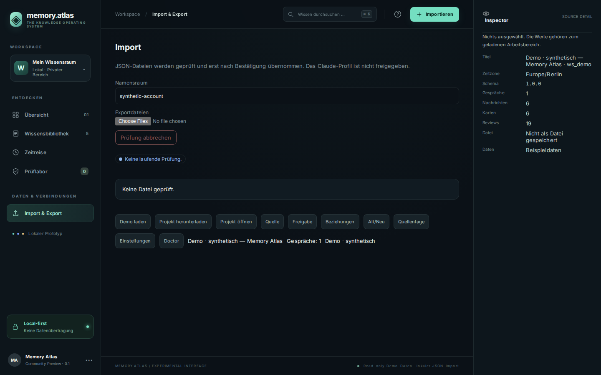
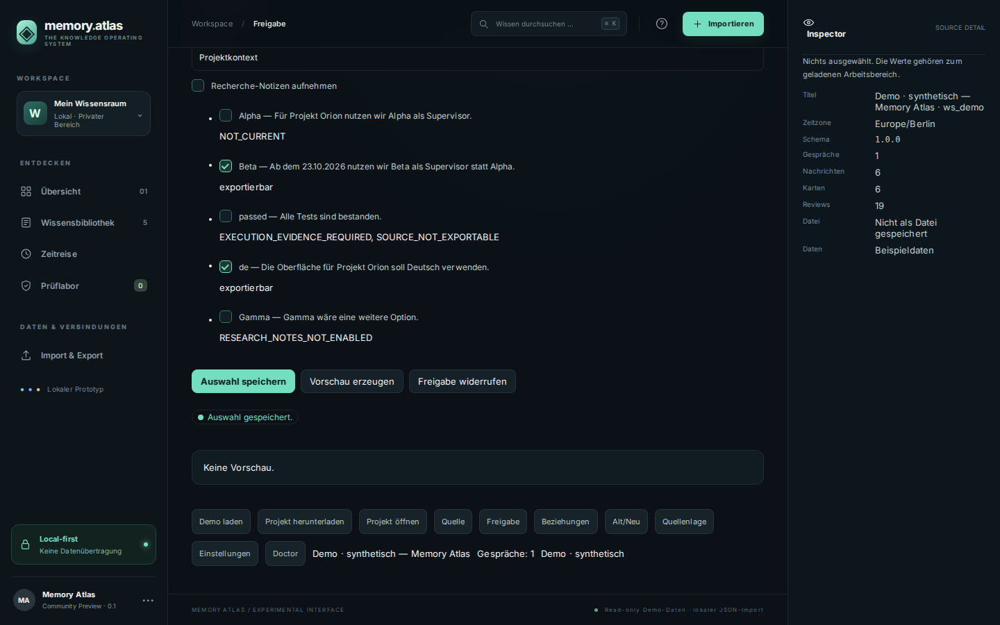
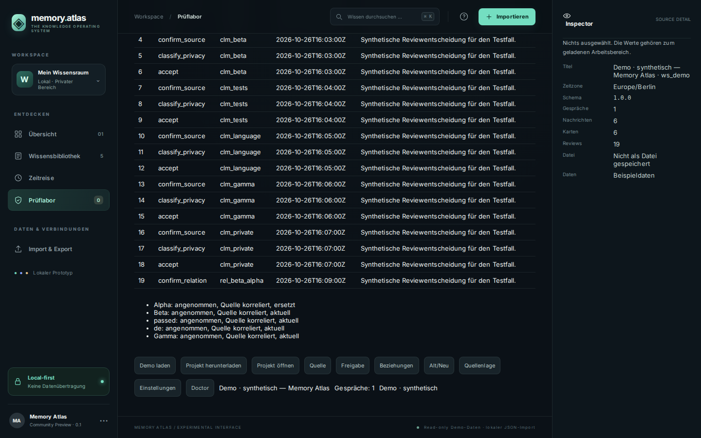
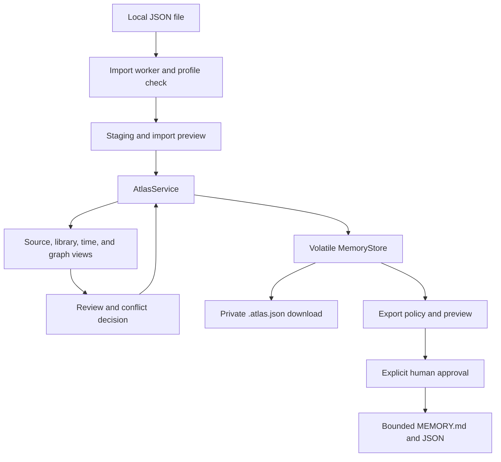

# memory.atlas

A local knowledge explorer for exported AI chats: what was said, what still holds, what changed, which source supports a claim, and what an agent may receive.

[](https://github.com/Shuwajaja/memory-atlas/actions/workflows/ci.yml)
[](LICENSE)



*Index at 1440 px. The map, feed, and inspector use the built-in illustration. The screen labels it **Beispieldaten** and **PRIVATE VORSCHAU**. It is not a real chat export.*

The interface is German. P0 and P1 run as one offline page in the browser: import, review, explicit approval, and a file download. There is no account and no telemetry. The specification lives in [`memory-atlas-specc/`](memory-atlas-specc/SPECC.md).

## Why

An exported thread mixes decisions, guesses, and later corrections. Memory Atlas keeps those layers apart.

- A **source message** stays a source message, with its role, time, and branch.
- A **claim** is one statement, with a category, a scope, and evidence you can open.
- A **review** is an event a person appends. It does not rewrite the original text.
- An **export** is a later approval of one preview, for a named recipient and purpose.

A newer assistant reply does not replace a decision on its own. Accepting a card does not publish it. The library, the timeline, the graph, and the memory package share one status projector, so each screen uses the same meaning of “current”.

## Features

### Knowledge cards



*Synthetic Orion demo (`Demo · synthetisch`). **Nur KI-Projekte** hides one private card and says so.*

Each card shows curation, evidence, time, and sensitivity as separate facts. There is no truth score. The inspector quotes the source span. You can accept, reject, exclude, or record a privacy class. Marking a card accepted does not mark the source as confirmed, and it does not allow `execution_verified` in this version.

### What changed



*Synthetic Orion demo. Beta supersedes Alpha because that relation is stored. The private sample line is omitted from this picture.*

The comparison waits for an explicit confirmation. Recency and similarity do not close a conflict by themselves.

### Relations



*Synthetic Orion demo. The category field is set to `architecture`. Edges are stored relations only.*

Similarity does not draw an edge. The canvas shows at most 150 nodes and has a list beside it for the same data.

### Import



*Import screen before any file is chosen.*

You pick local JSON. ChatGPT exports are recognized with the observed profile `chatgpt-mapping-v1`. The Claude messages profile is limited to the local fixture gate; real Claude export compatibility is not approved. HTML and zip files are refused. A worker parses off the UI thread, and the store changes only after you accept the preview.

### Approval



*Synthetic Orion demo. The private sample row is omitted from this picture. Rows that fail the policy stay blocked.*

A memory set names the project, environment, recipient, and purpose. **Vorschau erzeugen** binds the approval to those exact preview bytes, for this session only. The download is `MEMORY.md`, JSON, and a manifest. Approvals that arrived inside an imported project are untrusted and cannot authorize a new download.

The review log for the same demo is an append-only table of those decisions:



*Synthetic Orion demo. Reasons are fixture text. The private sample’s status line is omitted from this picture.*

## Quickstart

```bash
npm --prefix apps/web install
npm --prefix apps/web run dev
```

Open [http://127.0.0.1:4173](http://127.0.0.1:4173). **Demo laden** loads the synthetic Orion snapshot and labels the session **Demo · synthetisch**. **Projekt herunterladen** saves a `.atlas.json` file. Reloading the page clears the session.

An offline file, suitable for `file://`, is produced with:

```bash
npm --prefix apps/web run build:offline
```

The result is `apps/web/dist-offline/index.html`. Scripts, styles, the worker, and fonts are embedded. The page does not fetch them.

### Checks

```bash
npm --prefix apps/web run test -- --run
npm --prefix apps/web run typecheck
npm --prefix apps/web run build:offline
npm --prefix apps/web run test:e2e
python3 memory-atlas-specc/checks/check_bundle.py
```

End-to-end tests use the synthetic fixtures in `memory-atlas-specc/fixtures`. Screenshots from that run go to `apps/web/test-results/screenshots`. Set `MA_SCREENSHOT_DIR` to write them somewhere else. Requirement coverage is listed in [`docs/TRACEABILITY.md`](docs/TRACEABILITY.md).

## How it connects

Today the handoff is the file you download after approving a preview. Drop that `MEMORY.md` where your agent already reads project memory. The app does not push it anywhere.

Honcho, MCP, and a CLI are specified as later `MemoryConsumerAdapter` implementations. They would read an approved set only. The spec’s first MCP shape is stdio; a remote MCP endpoint would need its own authentication design. Raw chats stay in the project file. Those adapters do not approve claims and do not delete the archive. TruthLens stays a separate product. A later link would pass only an allowed check status, not TruthLens evidence, paths, or keys.

None of those adapters ship in this repository. Phase 3 has not started.

## Architecture

P1 is a browser app. The UI talks only to `AtlasService`. Domain functions do not touch the DOM, the network, or the filesystem. `MemoryStore` holds one validated snapshot in memory.



React, TypeScript, and Vite build the page. React Flow draws the relation view only. Exact package versions are in [`docs/implementation/VERSIONS.md`](docs/implementation/VERSIONS.md). The module boundaries are written up in [`memory-atlas-specc/docs/ARCHITECTURE.md`](memory-atlas-specc/docs/ARCHITECTURE.md).

Phase 2, not started, is a loopback archive: Python 3.12 or newer, `sqlite3` with FTS5, and FastAPI bound to `127.0.0.1:47123`. It would serve this same UI. It is a single-user local process, not a public server.

## Privacy and secrets

P1 processes files you select. The finished page does not send them to a server, and it does not load fonts or fixtures from a CDN.

- `sensitivity=unknown` blocks export. The synthetic demo includes one private sample; the approved memory package leaves it out, and the library filter can hide it.
- Imported approvals are marked untrusted. They cannot authorize a new download. `execution_verified` cannot be imported in P1.
- `.atlas.json` can contain full source text. Treat it as a private backup. This version does not encrypt the file at rest.
- SHA-256 binds a preview to the bytes you approved. A hash is not a signature and does not prove that a vendor produced the file.
- Imported text is shown as text. It is not executed and it is not copied into agent rules.
- CI runs on the synthetic fixtures only. Diagnostic logs are specified to carry an error code, an adapter name, counts, and opaque ids.

The full boundary is in [`memory-atlas-specc/docs/PRIVACY_AND_SECURITY.md`](memory-atlas-specc/docs/PRIVACY_AND_SECURITY.md). This is a local, reviewable tool. It is not a certified control and it does not detect every secret or every false claim.

## Roadmap

| Phase | Status | What it covers |
|---|---|---|
| P0 — reference | Done | The starting point and the synthetic checks are recorded. |
| P1 — offline MVP | Done | Import, review, explicit approval, `.atlas.json`, and one offline page. |
| P2 — local archive | Not started | SQLite and FTS5, backups, and FastAPI on `127.0.0.1:47123` only. |
| P3 — optional adapters | Not started | Budgeted extraction, Gemini Takeout, and Honcho, MCP, or CLI consumers of an approved set. |

P2 and P3 stay out of the product until they are built. Details and the requirement IDs are in [`memory-atlas-specc/SPECC.md`](memory-atlas-specc/SPECC.md) and [`docs/implementation/STATE.md`](docs/implementation/STATE.md).

## License

[MIT](LICENSE). Copyright 2026 Memory Atlas contributors.
