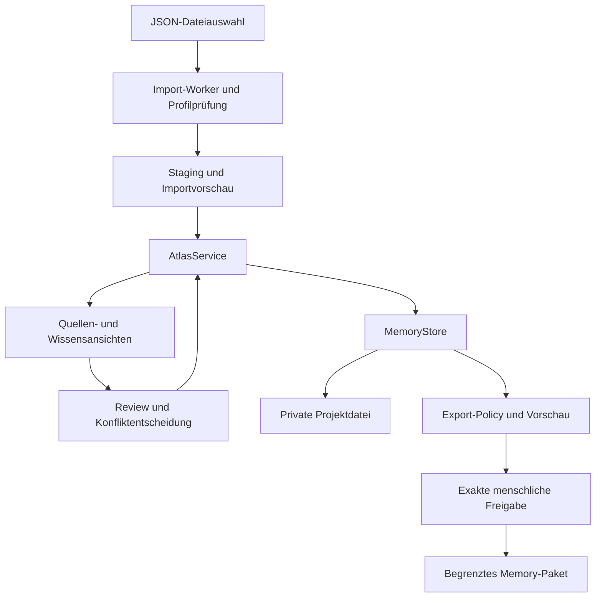

# Architektur und technische Entscheidungen

## 1. P1: lokaler Explorer

Bei leerem Repository: **React + TypeScript + Vite**, klare Feature-Verzeichnisse, kein Meta-Framework und kein Server-Rendering. Der Build erzeugt eine selbstständige Offline-Datei `dist-offline/index.html`; Skripte, CSS, Worker-Code und notwendige Assets werden lokal eingebettet. Der Worker kann aus einem eingebetteten Blob erzeugt werden. Kein `fetch()` für Fixtures, Module oder Fonts im fertigen `file://`-Build. Vites normaler Build allein garantiert das nicht; T1 muss die tatsächliche Offline-Ausgabe prüfen.

Im vorhandenen Repo wird zuerst geprüft, was bereits funktioniert. Ein geeigneter Stack darf die gleichen Verträge erfüllen. Der HTML-Prototyp bleibt als Design-/Verhaltensreferenz; vorhandene Parser werden erst nach Tests übernommen. Keine doppelte Entwicklung zweier vollständiger Apps.

Die UI spricht ausschließlich mit einem `AtlasService`, der Import, Reviews, Zeitprojektion und Export koordiniert. Reine Domain-Funktionen dürfen weder DOM noch Netzwerk noch Dateisystem benutzen. `MemoryStore` hält einen geprüften Snapshot. Herstellerdateien und `.atlas.json`-Projektdateien haben getrennte Decoder. Das Rohmaterial wird von daraus abgeleiteten Claims, Reviews und Memory-Sets getrennt gespeichert.

## 2. Module und Grenzen

| Modul | Verantwortung | Darf nicht |
|---|---|---|
| `importers` | Profil erkennen, normalisieren, Herkunft erhalten | Entscheidungen treffen oder Code aus Quellen ausführen |
| `domain/provenance` | Spannen/Hashes/Quellenpfade validieren | Aus einem Textmatch Wahrheit ableiten |
| `domain/projection` | Zustände aus Claims und Ereignissen berechnen | Historische Ereignisse überschreiben |
| `domain/conflicts` | Kandidaten für Konflikt/Dublette finden | Einen Konflikt selbst freigeben |
| `domain/export` | Zulässigkeit, Payload, Limits, Digest | Ohne Preview-Freigabe herunterladen |
| `store` | Snapshot transaktional ersetzen, Migration prüfen | Imports still zusammenführen |
| `features/*` | Interaktionen, Navigation, zugängliches Rendering | Eigene abweichende Fachregeln erzeugen |
| `adapters` | In späteren Phasen klar begrenzte Integration | Roharchiv ohne Freigabe weitergeben |

Es gibt einen einzigen fachlichen Claim-Statusprojektor. Graph, Karte, Tabelle und Export verwenden denselben Projektor; keine UI-spezifischen Wahrheitsregeln.

## 3. Persistenz im P1-MVP

`MemoryStore` ist flüchtig. „Projekt speichern“ lädt ein versioniertes `.atlas.json` herunter, das Rohquellen, Claims und Reviews enthält. „Projekt öffnen“ validiert diese Datei vollständig und ersetzt die Sitzung erst nach Bestätigung. Ein Fremdprojekt wird nicht automatisch mit dem aktuellen Workspace gemischt. Der Benutzer kann ein altes Backup bewusst öffnen; die App darf dessen Alter und enthaltene alte Freigaben nicht verschleiern.

Alle importierten Freigaben erhalten `approval_trust=imported_untrusted` in der Laufzeitschicht. Sie werden in der Historie angezeigt, autorisieren aber keinen neuen Download oder Sync. Aktuelle Memory-Ausgabe benötigt eine neue lokale Vorschau und Freigabe. Hashes dienen Integrität und Versionsbindung; ein Nutzer kann JSON und Hashes gemeinsam ändern. Daher ist dies kein manipulationssicheres Beweissystem.

Schema `1.0.0` ist das erste Format. Unbekannte Major-Version: nicht laden; bekannte ältere Minor-Version: expliziter reiner Migrationsschritt mit Originalbackup. Ein zukünftiger Versionswert wird nicht einfach ignoriert. Maximalgrößen gelten auch beim Öffnen von Projekten; `.atlas.json` hat zunächst 256 MiB, 100.000 normalisierte Nachrichtenrevisionen und 100.000 Review-Ereignisse als harte P1-Grenzen.

## 4. P2: dauerhaftes lokales Archiv

Konkreter Standard: Python 3.12 oder neuer, projektspezifische virtuelle Umgebung, `sqlite3` mit FTS5, FastAPI und Uvicorn. Python ist hier wegen des eingebauten SQLite-Zugriffs und der späteren Parser-/Modelladapter gewählt. Der Dienst bindet ausschließlich an `127.0.0.1:47123`, dient einer Person und liefert die gebaute UI selbst aus. Portkonflikt: verständlicher Fehler, kein Ausweichen auf `0.0.0.0`.

Entwicklungsabhängigkeiten und Endnutzer-Distribution unterscheiden: Entwickler benötigen Node plus Python, der spätere gebaute Dienst benötigt kein Node zur Laufzeit. Windows-Ziel ist ein Start unter einem normalen Benutzerkonto, ohne Docker, Administratorrechte, systemweiten Dienst oder eigene Datenbankinstallation. Ob ein vorliegendes Bundle dies erfüllt, wird auf Windows getestet; es ist keine bereits bewiesene Eigenschaft dieses Pakets.

Standarddatenpfad Windows: `%LOCALAPPDATA%/MemoryAtlas/workspaces/<workspace-id>/`; Linux: `$XDG_DATA_HOME/memory-atlas/` oder `~/.local/share/memory-atlas/`. Nicht im Git-Repository. Ein dokumentiertes `MEMORY_ATLAS_DATA_DIR` darf den Pfad explizit überschreiben. Kein automatischer Cloud-Ordner.

Tabellen: `source_files`, `import_batches`, `conversations`, `message_revisions`, `message_occurrences`, `branch_snapshots`, `claims`, `evidence`, `relations`, `review_events`, `memory_sets`, `export_manifests`, `tombstones`, `schema_migrations`. IDs/Felder folgen dem JSON-Vertrag. Häufige Filter werden indiziert, die Originaldaten bleiben separat von `messages_fts` und `claims_fts`. FTS-Indizes sind jederzeit rekonstruierbar.

SQLite: Fremdschlüssel pro Verbindung aktivieren, parameterisierte Queries, WAL lokal auf unterstütztem Dateisystem, ein koordinierter Writer, `busy_timeout` und begrenzte Wiederholungen. Vor Migration konsistentes Backup über die SQLite-Backup-API; bloßes Kopieren einer laufenden DB ohne WAL genügt nicht. Startprüfung erstellt und löscht eine temporäre FTS5-Tabelle. Fehlt FTS5, scheitert der Start mit Anleitung, statt einen anderen Suchmodus als FTS5 auszugeben.

Große Importe im P2-Dienst laufen stückweise mit Staging-Tabellen und persistiertem Jobzustand. Importcommit ist atomar, Fortsetzung erfolgt nur bei identischem Input-/Adapter-/Policy-Digest. Zielgrenze wird erst nach Benchmark von 128 MiB angehoben; keine unbelegte Zusage „beliebig große sechs Monate“.

## 5. P3: KI und Agenten als optionale Adapter

`ExtractionProvider` bekommt ausschließlich freigegebene Nachrichtenfenster und einen maschinenvalidierbaren Ergebnisvertrag. Ein Kandidat enthält Originalreferenzen; unauflösbare Zitate werden verworfen. Ein Modell kann weder Review-Ereignisse des Menschen erzeugen noch `execution_verified` setzen. Verarbeitungseinheit ist ein Gesprächszweig mit begrenztem Kontext, nicht ein blindes Ganzarchiv-Prompt.

Lokaler OpenAI-kompatibler Endpoint und Cloud-Endpoint sind separate Konfigurationen. Cloud-Verarbeitung benötigt eine konkrete Auswahlvorschau, Zielanbieter und Budget. Schlüssel verbleiben im lokalen Dienst/OS-Schlüsselspeicher, nie im Browserbundle oder Repo. Ein Chat-Abonnement wird nicht als API-Berechtigung vorausgesetzt.

Caching: Hash aus Nachrichtenrevisionen, Adapter-/Prompt-/Modell-/Policy-Version. Unveränderte Einheiten wiederverwenden. Budget vor jeder Einheit reservieren, bekannte Verbrauchswerte protokollieren; bei unbekanntem Preis explizites Tokenlimit und Warnhinweis in der Vorschau. Kein heimliches Weiterarbeiten nach Erreichen des Limits. Inkrementelle Review-Priorität: Konflikte, veraltete Entscheidungen und fehlende Belege vor weniger wichtigen Wiederholungen.

MCP/CLI/Honcho werden als `MemoryConsumerAdapter` nach dem Exportvertrag aufgebaut. Sie erhalten kein generelles Browserrecht auf Rohchats. MCP nutzt anfangs stdio, späterer Fernzugriff braucht einen gesonderten Authentifizierungsentwurf. Werkzeuge lesen nur passende freigegebene Sets; keine Tools zum Selbstfreigeben oder zum Löschen des Archivs.

TruthLens bleibt unabhängig. Eine spätere Verbindung respektiert D34: Der Agentenkanal erhält ausschließlich den erlaubten Prüfstatus. Memory Atlas darf keine TruthLens-Belege, internen Pfade oder Schlüssel durch den Adapter ausleiten. Ein Status ohne zur eigenen Behauptung passende vertrauenswürdige Bindung berechtigt nicht zu `execution_verified`.

## 6. Reproduzierbarkeit

Bei Projektstart konkrete kompatible Versionen wählen und Lockfiles festhalten. P1-Testwerkzeuge: Vitest, Browserprüfung mit Playwright und axe. Nur die tatsächlich gebrauchten Bibliotheken installieren. React Flow dient ausschließlich der Ansicht; maximal 150 Knoten, kein Graph-Backend. Keine zweite Graph-Bibliothek daneben.

Die in diesem Paket enthaltenen TypeScript-Dateien sind **Verträge**, nicht fertige App-Implementierungen. Daraus werden Implementierung, Adapter und Tests entwickelt. Datenmodell und Pure Functions müssen ohne UI testbar bleiben. Die Quellen für Technologieeigenschaften stehen in [SOURCES.md](SOURCES.md).
